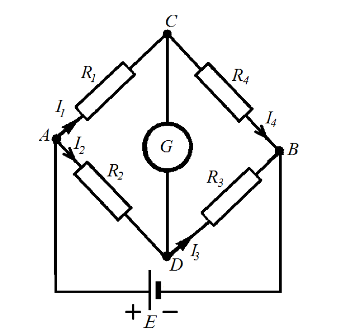
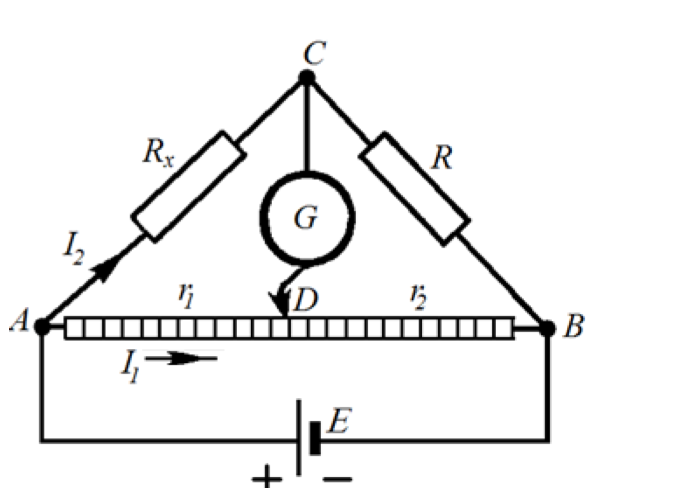
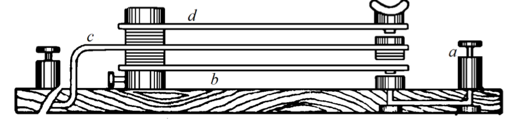

# Лабораторна робота № 1

## Визначення опору провідників постійного струму за допомогою мостової схеми

**Джерело:** [методичні вказівки](../../Електрика.%20Лабораторні%20роботи.pdf), с. 5–9. Опис структуровано за оригіналом; таблиці для запису результатів додано.

## Мета

Ознайомитися з методом визначення опору провідників за допомогою моста Уітстона. Виміряти два невідомі опори та перевірити формули їх послідовного і паралельного з'єднання.

## Обладнання

- Джерело постійного струму, 5 В.
- Реохорд з опором 102 Ом, лінійка.
- Гальванометр М 2031/1 з опором 4,1 кОм.
- Магазин опору Р34, 1–10 кОм, клас точності 0,1.
- Набір досліджуваних опорів: 500, 750, 1275, 3580, 8910 Ом.
- Подвійний ключ і з'єднувальні дроти.

## Теорія та схеми

Міст Уітстона має чотири плеча з опорами. В одну діагональ підключають джерело живлення, в іншу - чутливий гальванометр. У рівновазі потенціали точок підключення гальванометра однакові, тому струм через нього дорівнює нулю.

*Рис. 1 з оригіналу, с. 6. Принципова схема моста Уітстона.*

Для аналізу кола використовують правила Кірхгофа:

$$
\sum_i I_i = 0, \qquad \sum_i I_i R_i = \sum_j \mathcal{E}_j.
$$

Перше правило описує збереження заряду у вузлі; друге - баланс падінь напруги та ЕРС у замкненому контурі. Знаки обирають відповідно до напрямів струмів і обходу контуру. Для позначень рис. 1 умова рівноваги:

$$
\frac{R_1}{R_2}=\frac{R_4}{R_3}.
$$

*Рис. 2 з оригіналу, с. 7. Практична реалізація мостової схеми.*

У практичній схемі два плеча утворюють відрізки однорідного реохорда. Їх опори пропорційні довжинам $l_1=AD$ і $l_2=DB$. Якщо $R$ - відомий опір магазину, то:

$$
R_x=R\frac{l_1}{l_2}=R\frac{l_1}{l-l_1}, \qquad l=l_1+l_2.
$$

Для оцінки граничної відносної похибки в методичці наведено:

$$
\delta_{R_x}=\frac{\Delta R}{R}+\frac{\Delta l_1}{l_1}
+\frac{\Delta l+\Delta l_1}{l-l_1},
\qquad \Delta R_x=R_x\delta_{R_x}.
$$

Похибку магазину визначають за його класом точності та паспортом. Контакт доцільно тримати близько до середини реохорда: малі довжини одного з плечей збільшують відносну похибку.

*Рис. 3 з оригіналу, с. 8. Подвійний ключ.*

Подвійний ключ спочатку замикає коло джерела, потім коло гальванометра; розмикає їх у зворотному порядку. Так гальванометр захищений від перехідних імпульсів. Міст вмикають ненадовго, щоб нагрівання не змінювало опори.

## Порядок виконання

1. Зібрати схему за рис. 2. Підключити перший невідомий опір.
2. Встановити контакт посередині реохорда, а захист гальванометра - у режим «грубо».
3. Добитися наближеної рівноваги, змінюючи опір магазину $R$.
4. Підвищити чутливість до режиму «точно» й остаточно збалансувати міст переміщенням контакту.
5. Записати $R$, $l_1$, $l_2$ та обчислити $R_x$. Провести три вимірювання й оцінити похибку.
6. Повторити дослід для другого невідомого опору.
7. Виміряти опір паралельного, потім послідовного з'єднання цих двох опорів.
8. Порівняти результати з розрахунками:

$$
R_{\parallel}=\frac{R_{x1}R_{x2}}{R_{x1}+R_{x2}},
\qquad R_{\mathrm{посл}}=R_{x1}+R_{x2}.
$$

9. Виміряти опір омметром та порівняти з мостовим методом. Зробити висновки.

> **Уточнення джерела.** В оригіналі захисний опір описано і як шунт, і як послідовний опір; вказівки щодо його збільшення/зменшення суперечливі. Орієнтуйтеся на режими «грубо»/«точно» та фактичну схему приладу. У розрахунку $R$ означає опір магазину; позначення $R_3$ у порядку виконання приведено до цього позначення.

## Таблиця результатів

Заповнити по три рядки для кожного окремого опору та їх з'єднань.

| Об'єкт | № | $R$, Ом | $l_1$, мм | $l_2$, мм | $R_x$, Ом | $\Delta R_x$, Ом |
| --- | --- | --- | --- | --- | --- | --- |
| Перший опір | 1 | | | | | |
| Перший опір | 2 | | | | | |
| Перший опір | 3 | | | | | |
| Другий опір | 1 | | | | | |
| Паралельне з'єднання | 1 | | | | | |
| Послідовне з'єднання | 1 | | | | | |

## Що подати у звіті

Схему, таблиці, середні опори з похибками, порівняння з омметром і розрахунками з'єднань. У висновку зазначити, чи узгоджуються результати в межах похибки.

## Контрольні питання

1. У чому полягає принцип мостової схеми?
2. Сформулюйте правила Кірхгофа та закон Ома для ділянки кола.
3. Як залежить опір металевого дроту від геометричних розмірів?
4. Виведіть формули опору послідовного і паралельного з'єднань.
5. Чому час роботи мостової схеми має бути мінімальним?

---

[До переліку робіт і загальних вказівок](../README.md)
