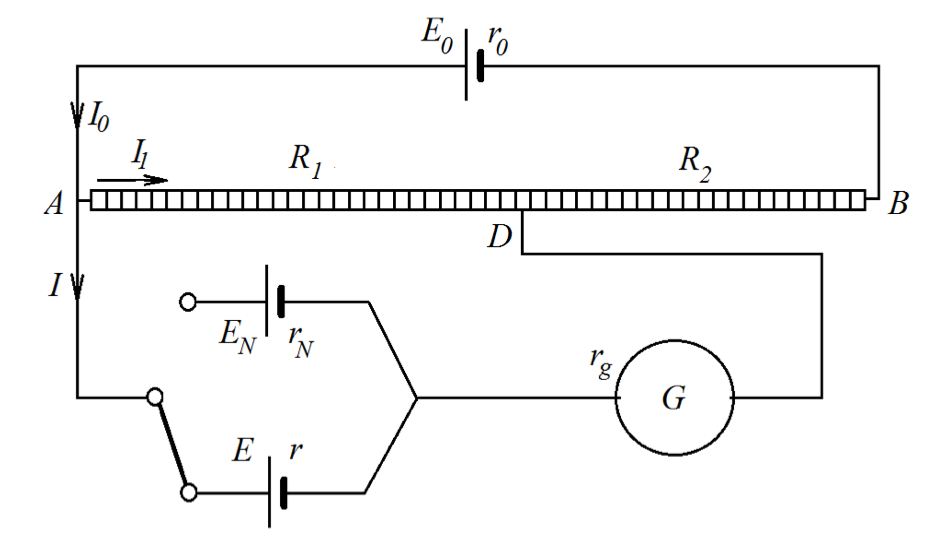

# Лабораторна робота № 2

## Визначення електрорушійної сили джерела струму методом компенсації

**Джерело:** [методичні вказівки](../../Електрика.%20Лабораторні%20роботи.pdf), с. 9–13. Опис структуровано за оригіналом; таблицю для запису результатів додано.

## Мета

Ознайомитися з компенсаційним методом вимірювання та визначити електрорушійну силу (ЕРС) елемента порівнянням з еталонним джерелом.

## Обладнання

Джерело постійного струму, нормальний елемент Э303, джерело з невідомою ЕРС, реохорд з опором 102 Ом, лінійка, чутливий амперметр М 265, подвійний ключ, з'єднувальні дроти.

## Теорія

ЕРС - робота сторонніх сил при перенесенні одиничного заряду:

$$
\mathcal{E}=\frac{A_{\mathrm{стор}}}{q}.
$$

Її вимірюють у вольтах. Для джерела з внутрішнім опором $r$ напруга на клемах під час віддавання струму:

$$
U=\mathcal{E}-Ir.
$$

Підключення вольтметра створює струм і падіння напруги на внутрішньому опорі. Метод компенсації дає змогу вимірювати ЕРС при нульовому струмі через досліджуване джерело.

*Рис. 4 з оригіналу, с. 10. Схема визначення ЕРС методом компенсації.*

Допоміжне джерело $\mathcal{E}_0$ підтримує струм $I_0$ у реохорді. Досліджуваний елемент підключають так, щоб його ЕРС протидіяла падінню напруги на вибраній ділянці реохорда. Переміщенням контакту знаходять положення, де струм через нульовий прилад зникає:

$$
\mathcal{E}_x=I_0R_x, \qquad \mathcal{E}_N=I_0R_N.
$$

Тут $R_x$ та $R_N$ - опори ділянок реохорда, які компенсують відповідні ЕРС. За незмінного робочого струму та однорідного реохорда:

$$
\frac{\mathcal{E}_x}{\mathcal{E}_N}=\frac{R_x}{R_N}=\frac{l_x}{l_N},
\qquad \boxed{\mathcal{E}_x=\mathcal{E}_N\frac{l_x}{l_N}}.
$$

Допоміжна ЕРС має перевищувати обидві порівнювані ЕРС і залишатися стабільною. Переваги методу: немає падіння напруги на внутрішньому опорі елемента; шкала нульового приладу не входить у формулу; невідомий робочий струм скорочується при порівнянні.

Подвійний ключ замикає допоміжне коло раніше кола нульового приладу. Його будову показано в [роботі № 1](../lab_1/README.md).

## Порядок виконання

1. Зібрати схему за рис. 4. Встановити захист нульового приладу в режим «грубо».
2. Підключити нормальний елемент $\mathcal{E}_N$, поставити контакт посередині реохорда й відрегулювати робочий струм до компенсації.
3. Перейти до режиму «точно», повторно добитися нульового показу. Записати довжину $l_N$ від спільного початку реохорда до контакту.
4. Перемкнути схему на невідомий елемент, повернути захист у режим «грубо». Робочий струм допоміжного кола після калібрування не змінювати.
5. Переміщенням контакту знайти компенсацію, уточнити нульовий показ у чутливому режимі й записати $l_x$.
6. Взяти значення $\mathcal{E}_N$ з таблиці або у лаборанта. Обчислити $\mathcal{E}_x$.
7. Повторити вимірювання декілька разів і знайти середнє значення.
8. Оцінити похибку та зробити висновок.

За припущенням методички похибка визначається лише вимірюванням довжин:

$$
\delta_{\mathcal{E}}=\frac{\Delta l_x}{l_x}+\frac{\Delta l_N}{l_N},
\qquad \Delta\mathcal{E}_x=\mathcal{E}_x\delta_{\mathcal{E}}.
$$

Взяти $\Delta l_x=\Delta l_N=1$ мм; усі довжини у формулі мають бути в однакових одиницях. Якщо похибка еталона істотна, до оцінки додати $\Delta\mathcal{E}_N/\mathcal{E}_N$.

> **Уточнення джерела.** В оригіналі суперечливо описано регулювання опору захисту нульового приладу. Режими «грубо»/«точно» тут наведено без припущення, що цей опір є саме шунтом. Довжини $l_N$ і $l_x$ відлічують до рухомого контакту, позначеного на рис. 4 літерою D.

## Таблиця результатів

Еталонна ЕРС: $\mathcal{E}_N=\underline{\hspace{2cm}}$ В.

| № | $l_N$, мм | $l_x$, мм | $\mathcal{E}_x$, В | $\delta_{\mathcal{E}}$ | $\Delta\mathcal{E}_x$, В |
| --- | --- | --- | --- | --- | --- |
| 1 | | | | | |
| 2 | | | | | |
| 3 | | | | | |

## Що подати у звіті

Компенсаційну схему, еталонну ЕРС, таблицю довжин, розрахунки окремих і середньої ЕРС з похибкою. Пояснити, чому під час вимірювання потрібно зберігати робочий струм.

## Контрольні питання

1. Сформулюйте правила Кірхгофа та закон Ома для повного кола.
2. Що таке ЕРС елемента і в яких одиницях її вимірюють?
3. Чому для підтримання різниці потенціалів потрібні сторонні сили?
4. Чому роботу в замкненому колі виконують сторонні, а не кулонівські сили?
5. У чому суть методу компенсації?
6. Чому робочий струм має бути постійним?
7. Яка внутрішня будова і принцип роботи акумулятора?

---

[До переліку робіт і загальних вказівок](../README.md)
