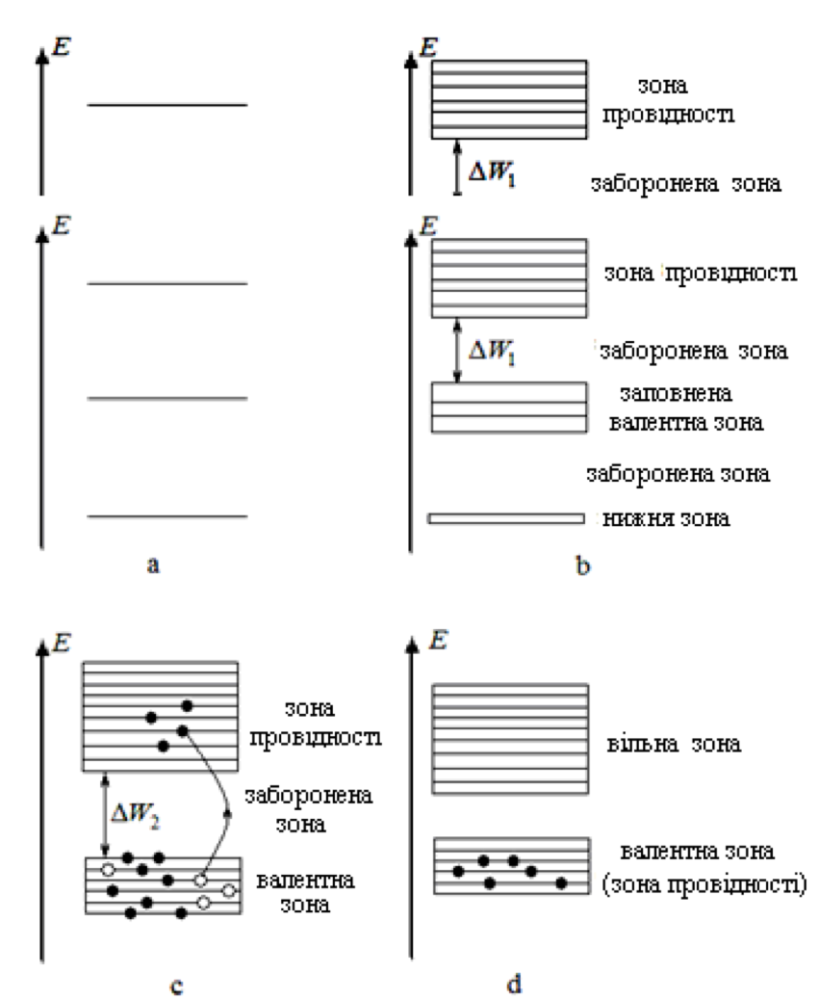
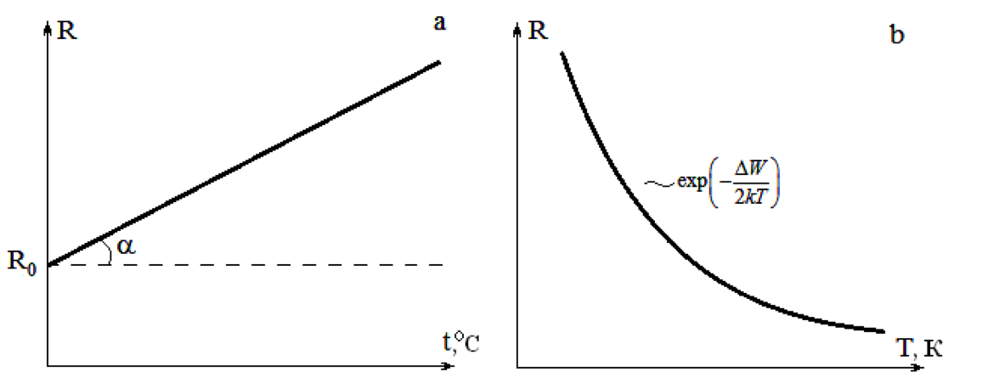
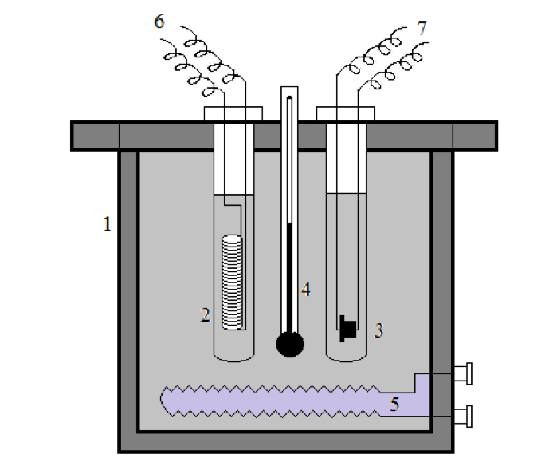

# Лабораторна робота № 3

## Вивчення температурних залежностей електропровідності металів та напівпровідників

**Джерело:** [методичні вказівки](../../Електрика.%20Лабораторні%20роботи.pdf), с. 13–19. Опис структуровано за оригіналом; пояснення обробки графіків уточнено.

## Мета

Дослідити залежність опору металу та напівпровідника від температури. Визначити температурний коефіцієнт опору мідного дроту та оцінити ширину забороненої зони напівпровідника.

## Обладнання

Мікротермостат потужністю 150 Вт з живленням 220 В, дві пробірки, моток мідного дроту з опором близько 25 Ом, напівпровідниковий резистор близько 1 МОм, міст постійного струму, омметр, термометр та з'єднувальні дроти.

## Теорія та ілюстрації

В окремому атомі електрони мають дискретні енергетичні рівні. У твердому тілі через взаємодію атомів рівні утворюють дозволені зони, розділені забороненими зонами.

*Рис. 5 з оригіналу, с. 14: a - окремий атом; b - діелектрик; c - напівпровідник; d - метал.*

У металі є доступні стани поблизу зайнятих, тому електрони можуть переносити струм. У діелектрика заповнена валентна зона відокремлена широкою забороненою зоною. У напівпровідника ця зона вужча; нагрівання створює електрони провідності та дірки. Донорні домішки дають переважно електронну, акцепторні - діркову провідність.

### Метал

З нагріванням посилюється розсіювання електронів на коливаннях кристалічної ґратки, тому опір зростає. Загальна апроксимація:

$$
R(t)=R_0(1+\alpha t+\beta t^2).
$$

У невеликому температурному інтервалі використовують лінійну модель:

$$
R(t)=R_0(1+\alpha t)=a+bt,
\qquad R_0=a,\qquad \alpha=\frac{b}{a}.
$$

Тут $t$ вимірюють у °C, $R_0$ - опір при 0 °C, $\alpha$ - температурний коефіцієнт у К$^{-1}$. Значення $a$ визначають екстраполяцією прямої до $t=0$.

### Напівпровідник

У моделі власної провідності концентрація носіїв зростає з температурою:

$$
n=n_0\exp\left(-\frac{\Delta W}{2k_BT}\right).
$$

Якщо вплив рухливості носіїв на температурну залежність слабший, то:

$$
R(T)=A\exp\left(\frac{\Delta W}{2k_BT}\right),
\qquad \ln R=\ln A+\frac{\Delta W}{2k_B}\frac{1}{T}.
$$

$T=t+273{,}15$ - температура у К, $A$ - коефіцієнт моделі. Для лінійної апроксимації $\ln R=c+m/T$:

$$
\Delta W=2k_Bm.
$$

При $k_B=8{,}617333262\cdot10^{-5}$ еВ/К результат отримують в еВ. При $k_B=1{,}380649\cdot10^{-23}$ Дж/К результат спершу отримують у джоулях; $1$ еВ $=1{,}602176634\cdot10^{-19}$ Дж.

*Рис. 6 з оригіналу, с. 16: a - зростання опору металу; b - зменшення опору напівпровідника.*

На самому рисунку біля кривої b надруковано від’ємний знак у показнику експоненти. Це суперечить формулі опору в тексті: для $R(T)$ показник додатний, а від’ємний знак належить залежності концентрації носіїв. Вирізаний рисунок збережено без перемальовування.

> **Уточнення обробки.** «Тангенс кута нахилу» у методичці означає нахил у числових одиницях осей, а не кут на довільно масштабованому рисунку. Для металу це $b=\Delta R/\Delta t$, для напівпровідника $m=\Delta(\ln R)/\Delta(1/T)$. Логарифмувати слід числові значення опору в одних і тих самих одиницях. Отримана $\Delta W$ є оцінкою в межах прийнятої моделі власної провідності.

*Рис. 7 з оригіналу, с. 18: 1 - мікротермостат; 2 - металевий дріт; 3 - напівпровідниковий резистор; 4 - термометр; 5 - електронагрівач; 6 - дроти до моста; 7 - дроти до омметра.*

Зразки розміщують у двох пробірках у водяній ванні. Вимірювати потрібно після встановлення теплової рівноваги.

## Порядок виконання

1. Ознайомитися з будовою термостата. Підключити металевий зразок до моста, напівпровідниковий - до омметра відповідно до наявної установки.
2. Встановити температуру 30 °C; дочекатися, поки зразки набудуть температури ванни.
3. Виміряти опори обох зразків.
4. Повторити вимірювання при 40, 50, 60, 70 та 80 °C.
5. Обчислити $T$, $1/T$ та $\ln R$ напівпровідника.
6. Побудувати $R_{\mathrm{мет}}(t)$ та $\ln R_{\mathrm{нап}}(1/T)$, провести лінійну апроксимацію.
7. За нахилами та перетином з віссю визначити $\alpha$ і $\Delta W$.
8. Зробити висновок про протилежний характер температурних залежностей.

У джерелі є різні вказівки щодо вимірювача напівпровідникового опору: опис установки називає омметр, порядок виконання - міст. Тут наведено підключення з опису установки та рис. 7.

## Таблиця результатів

| $t$, °C | 30 | 40 | 50 | 60 | 70 | 80 |
| --- | --- | --- | --- | --- | --- | --- |
| $R_{\mathrm{мет}}$, Ом | | | | | | |
| $R_{\mathrm{нап}}$, Ом | | | | | | |
| $\ln(R_{\mathrm{нап}}/1\,\mathrm{Ом})$ | | | | | | |
| $T$, К | 303,15 | 313,15 | 323,15 | 333,15 | 343,15 | 353,15 |
| $1/T$, К$^{-1}$ | | | | | | |

## Що подати у звіті

Таблицю, два графіки з одиницями осей, рівняння апроксимуючих прямих, розрахунки $\alpha$ та $\Delta W$ в еВ. За наявності похибок вимірювання оцінити невизначеність параметрів апроксимації. Числових вимірювань у вихідній методичці немає.

## Контрольні питання

1. Чим відрізняються провідники, напівпровідники і діелектрики з погляду зонної теорії?
2. Чому електрони нижніх заповнених зон не беруть участі в перенесенні заряду?
3. Що таке електронна та діркова провідність?
4. Чому опір металів зростає з підвищенням температури?
5. Як опір напівпровідника залежить від температури?

---

[До переліку робіт і загальних вказівок](../README.md)
