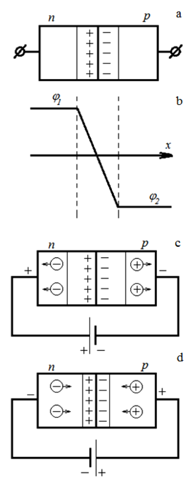
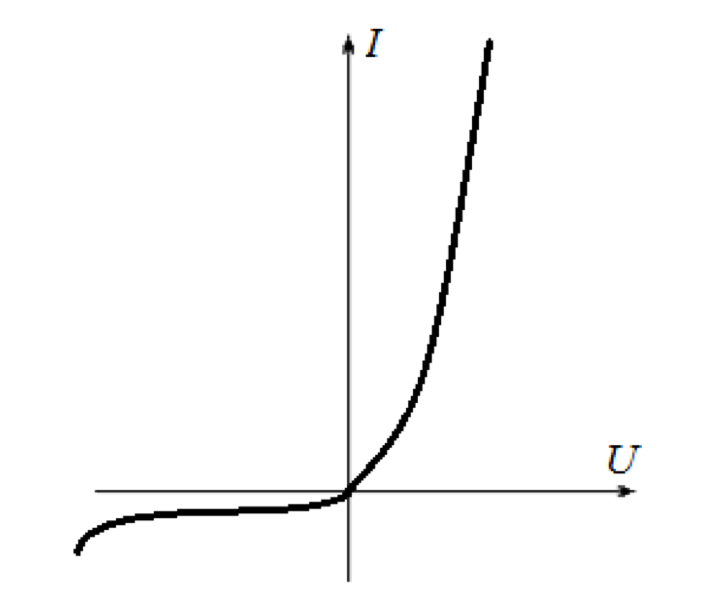
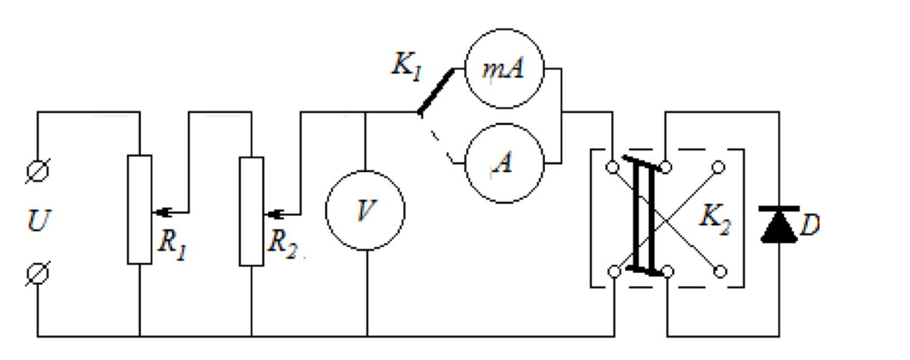

# Лабораторна робота № 4

## Вивчення вольтамперної характеристики напівпровідникового діода

**Джерело:** [методичні вказівки](../../Електрика.%20Лабораторні%20роботи.pdf), с. 20–24. Опис структуровано за оригіналом; таблиці й уточнення позначень додано.

## Мета

Побудувати вольтамперну характеристику діода, визначити залежність його опору від прикладеної напруги та оцінити коефіцієнт випрямлення.

## Обладнання

Джерело постійного струму на 2 В, два реостати, вольтметр до 2 В, амперметри М109 і М252 з межами 10 мкА та 15 мА, ключі, напівпровідниковий діод і з'єднувальні дроти.

## Теорія та ілюстрації

Донорні домішки створюють у напівпровіднику переважно електронну провідність ($n$-тип), акцепторні - діркову ($p$-тип). На межі областей утворюється $p$–$n$-перехід. Електрони та дірки дифундують через межу й рекомбінують, залишаючи нерухомі заряджені домішкові іони. Виникають збіднений носіями шар та внутрішнє поле, яке протидіє подальшій дифузії.

*Рис. 8 з оригіналу, с. 22: a - перехід без зовнішньої напруги; b - розподіл потенціалу; c - зворотне зміщення; d - пряме зміщення.*

При прямому зміщенні до $p$-області прикладають додатний потенціал, до $n$-області - від'ємний. Бар'єр зменшується, струм зростає. При зворотному зміщенні бар'єр і ширина збідненого шару зростають; до пробою проходить малий струм неосновних носіїв.

> **Уточнення джерела.** У підписі рис. 8 прямий і зворотний режими c/d переплутано. Тут назви відповідають полярності, зображеній на рисунку, та поясненню в основному тексті.

*Рис. 9 з оригіналу, с. 23. Характерний вигляд залежності $I(U)$.*

Діод є нелінійним елементом: відношення напруги до струму змінюється з робочою точкою. У цій роботі визначають статичний опір:

$$
R(U)=\frac{\lvert U\rvert}{\lvert I\rvert}.
$$

При нульовому струмі це відношення не обчислюють. Диференційний опір $r_d=dU/dI$ є іншою характеристикою і не підміняє статичного опору.

Для однакових за модулем прямої та зворотної напруг зручно явно визначити коефіцієнт випрямлення:

$$
K=\frac{R_{\mathrm{зв}}}{R_{\mathrm{пр}}}
=\frac{\lvert I_{\mathrm{пр}}\rvert}{\lvert I_{\mathrm{зв}}\rvert}.
$$

Методичка говорить про «відношення опорів при прямій та оберненій напрузі», але не задає його порядок. У звіті потрібно вказати обрану домовленість; тут використано зворотний опір, поділений на прямий.

*Рис. 10 з оригіналу, с. 23: D - діод; $R_1$, $R_2$ - реостати; V - вольтметр; $K_1$, $K_2$ - ключі; струмові прилади - для різних діапазонів струму.*

## Порядок виконання

1. Зібрати коло за рис. 10. Вибрати прилад та межу для вимірювання прямого струму.
2. Для прямого зміщення плавно змінювати напругу реостатами. Записувати напругу на діоді й струм через нього.
3. Вимкнути живлення перед зміною підключення; встановити зворотну полярність та відповідний чутливий струмовий прилад.
4. Повторити вимірювання для зворотного зміщення в межах напруги установки й діапазонів приладів.
5. Побудувати прямий і зворотний відрізки $I(U)$, явно вказавши одиниці струму. Для спільної ВАХ прийняти прямі $U,I$ додатними, зворотні - від'ємними.
6. Перевести всі струми в ампери та обчислити $R(U)$ для ненульових струмів.
7. Побудувати залежності опору від прямої і зворотної напруги.
8. Для однакових $\lvert U\rvert$ розрахувати $K$ і зробити висновок про випрямні властивості.

## Таблиці результатів

| № | $U_{\mathrm{пр}}$, В | $I_{\mathrm{пр}}$, мА | $R_{\mathrm{пр}}$, Ом |
| --- | --- | --- | --- |
| 1 | | | |
| 2 | | | |
| 3 | | | |

| № | $\lvert U_{\mathrm{зв}}\rvert$, В | $\lvert I_{\mathrm{зв}}\rvert$, мкА | $R_{\mathrm{зв}}$, Ом | $K$ при тому самому $\lvert U\rvert$ |
| --- | --- | --- | --- | --- |
| 1 | | | | |
| 2 | | | | |
| 3 | | | | |

Таблиці продовжити для всіх виміряних точок. Якщо зворотний струм нижчий за чутливість приладу, зазначити межу вимірювання замість вигаданого нульового значення опору або точного $K$.

## Що подати у звіті

Схему, обидві таблиці, графік ВАХ, графіки $R(U)$ та коефіцієнти випрямлення з явно заданою домовленістю. Пояснити, чому прямий і зворотний струми суттєво відрізняються.

## Контрольні питання

1. Який механізм діркової провідності?
2. Як зонна теорія пояснює дію донорних і акцепторних домішок?
3. Чому на контакті двох областей напівпровідника виникає контактна різниця потенціалів?
4. Поясніть вольтамперну характеристику напівпровідникового діода.

---

[До переліку робіт і загальних вказівок](../README.md)
