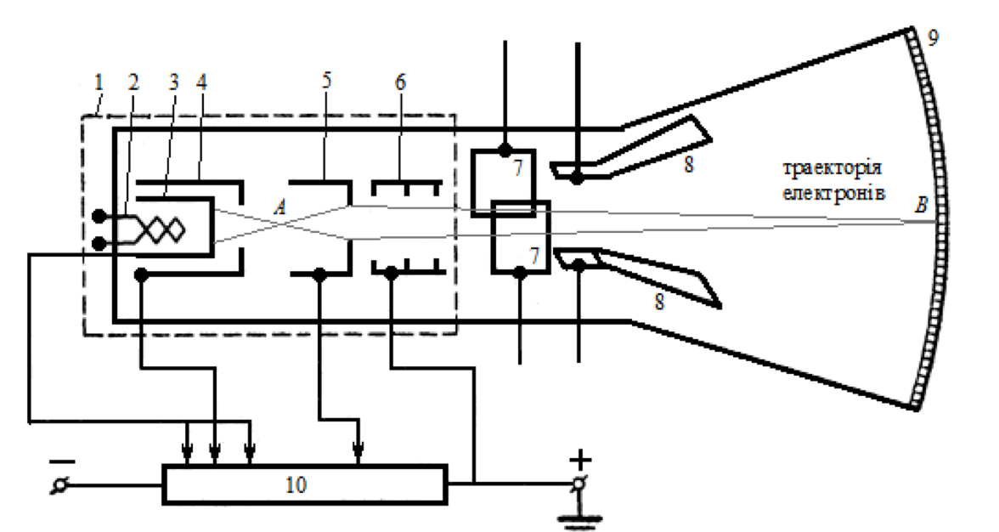
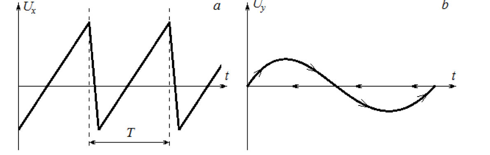

# Лабораторна робота № 5

## Вивчення роботи електронного осцилографа

**Джерело:** [методичні вказівки](../../Електрика.%20Лабораторні%20роботи.pdf), с. 24–28. Опис структуровано за оригіналом; таблиці та формулу перерахунку чутливості додано.

## Мета

Ознайомитися з будовою і роботою електронного осцилографа. Визначити чутливість горизонтального каналу та спостерігати фігури Ліссажу для різних співвідношень частот.

## Обладнання

Осцилограф С 1-1, електронно-променева трубка, джерело змінної напруги до 220 В частотою 50 Гц, реостат, звуковий генератор ГЗ-33 (20–17 000 Гц) і з'єднувальні дроти. У порядку виконання також використовується автотрансформатор для регулювання напруги на вході X.

## Будова і принцип роботи

Осцилограф дає змогу спостерігати форму швидкозмінного сигналу, порівнювати амплітуди й частоти та вимірювати часові інтервали. Основні блоки: електронно-променева трубка, підсилювачі сигналів, генератор розгортки та блок живлення.

*Рис. 11 з оригіналу, с. 25: 1 - електронна пушка; 2 - нитка розжарювання; 3 - катод; 4 - керуючий електрод; 5 - фокусуючий анод; 6 - прискорюючий анод; 7 - горизонтально відхиляючі пластини; 8 - вертикально відхиляючі пластини; 9 - флуоресцентний екран; 10 - потенціометр.*

Нагрітий катод випускає електрони. Керуючий електрод регулює їх кількість і яскравість плями, аноди прискорюють та фокусують пучок. Дві пари пластин відхиляють промінь у горизонтальному та вертикальному напрямах. При попаданні електронів на екран виникає світіння.

За сталих налаштувань відхилення пропорційне напрузі:

$$
x=\alpha_xU_x,\qquad y=\alpha_yU_y.
$$

$\alpha_x$ та $\alpha_y$ - чутливості, наприклад у мм/В. Фокусування змінюють потенціалом першого анода, яскравість - потенціалом керуючого електрода.

### Генератор розгортки

*Рис. 12 з оригіналу, с. 27: a - пилоподібна напруга розгортки; b - періодичний сигнал на екрані.*

На вхід горизонтального відхилення подають напругу, яка лінійно зростає, а потім швидко повертається до початкового рівня. Під час прямого ходу $x$ пропорційний часу. Якщо на Y подати досліджуваний сигнал, екран показує його часову залежність.

Стійка картина виникає при синхронізації. Якщо період розгортки $T_{\mathrm{розг}}=nT_{\mathrm{сиг}}$, за один прямий хід видно $n$ періодів сигналу. Без синхронізації зображення зміщується або накладається саме на себе.

### Фігури Ліссажу

При вимкненій розгортці та подачі синусоїдальних сигналів на обидва входи:

$$
x(t)=A\sin(2\pi f_xt),\qquad y(t)=B\sin(2\pi f_yt+\varphi).
$$

Утворюються фігури Ліссажу, форма яких залежить від співвідношення частот, амплітуд і фаз. Для сталого раціонального співвідношення частот фігура замкнена; нестабільність сигналів спричиняє її зміну.

## Порядок виконання

### 1. Ознайомлення з приладом

До ввімкнення визначити призначення ручок управління, входів X і Y, розглянути будову трубки. Після ввімкнення налаштувати чітку пляму та зафіксувати підсилення на час вимірювань.

### 2. Визначення чутливості горизонтального каналу

1. Вимкнути генератор розгортки.
2. Подати на X змінну напругу частотою 50 Гц через автотрансформатор у схемі установки; за методичкою напруга має бути не більшою за 45–50 В.
3. Для кількох значень напруги виміряти повну довжину світлової смужки $L$ у мм.
4. Побудувати графік $L(U)$ та знайти його нахил $b=\Delta L/\Delta U$.
5. Навести чутливість при обраному підсиленні з явним зазначенням способу вимірювання напруги.

> **Уточнення обробки.** У методичці нахил графіка $L(U)$ названо чутливістю без уточнення амплітуди. Якщо $L$ - повна довжина смужки, а $U$ - діюче значення синусоїдальної напруги, то $L=2\sqrt{2}\alpha_xU$ і $\alpha_x=b/(2\sqrt{2})$. Сам нахил $b$ можна подати окремо як чутливість повної довжини смужки до діючої напруги. Застосовувати зазначену напругу слід лише до передбаченого методичкою приладу й входу лабораторної установки.

| № | $U_{\mathrm{еф}}$, В | $L$, мм |
| --- | --- | --- |
| 1 | | |
| 2 | | |
| 3 | | |
| 4 | | |

### 3. Спостереження фігур Ліссажу

1. Залишити розгортку вимкненою. На X подати сигнал 50 Гц, на Y - сигнал звукового генератора.
2. Змінювати частоту генератора, добиваючись стійких фігур для співвідношень 1:1, 1:2, 1:3, 1:4.
3. Замалювати або сфотографувати кожну фігуру, записати частоти та їх співвідношення.

У таблиці прийнято порядок $f_x:f_y$; у вихідному тексті порядок чисел не уточнений.

| $f_x:f_y$ | $f_x$, Гц | Очікувана $f_y$, Гц | Фактична $f_y$, Гц | Ескіз або фото |
| --- | --- | --- | --- | --- |
| 1:1 | 50 | 50 | | |
| 1:2 | 50 | 100 | | |
| 1:3 | 50 | 150 | | |
| 1:4 | 50 | 200 | | |

## Що подати у звіті

Опис блоків осцилографа, таблицю $L(U)$, графік та чутливість із зазначенням підсилення, чотири фігури Ліссажу й частоти. Пояснити умову стійкого зображення. Наведені частоти є орієнтирами, а не результатами проведеного досліду.

## Контрольні питання

1. Яка будова електронного осцилографа?
2. Що називають чутливістю електронно-променевої трубки?
3. Як здійснюється фокусування електронного променя?
4. Як поводиться промінь при постійній, синусоїдальній і пилоподібній напрузі?
5. Поясніть роботу генератора розгортки.
6. Коли спостерігаються фігури Ліссажу?

---

[До переліку робіт і загальних вказівок](../README.md)
