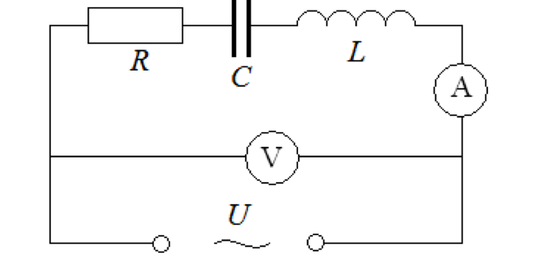
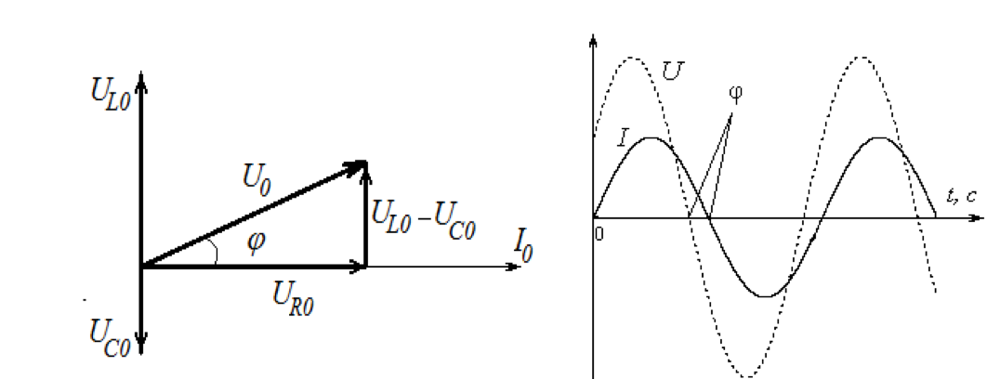

# Лабораторна робота № 6

## Перевірка закону Ома для кола змінного струму

**Джерело:** [методичні вказівки](../../Електрика.%20Лабораторні%20роботи.pdf), с. 28–32. Опис структуровано за оригіналом; таблиці й пояснення обробки додано.

## Мета

Експериментально визначити повний опір кола змінного струму та порівняти його з теоретичним. Визначити індуктивність котушки без осердя та із залізним осердям.

У формулюванні мети оригіналу також згадано визначення ємності конденсатора, але окремого завдання для цього в порядку виконання немає. Нижче описано обидва наявні завдання; самостійне вимірювання ємності міститься в [роботі № 8](../lab_8/README.md).

## Обладнання

Котушка індуктивністю 107,7 мГн і активним опором 10,5 Ом, два конденсатори по 10 мкФ, реостат, амперметр змінного струму до 0,5 А, вольтметр до 100 В, ключ, лабораторний автотрансформатор (ЛАТР). Для другого завдання використовується залізне осердя.

## Теорія та схеми

Кругова частота:

$$
\omega=2\pi f.
$$

Для синусоїдального сигналу діючі значення пов'язані з амплітудами:

$$
U_{\mathrm{еф}}=\frac{U_0}{\sqrt{2}},\qquad I_{\mathrm{еф}}=\frac{I_0}{\sqrt{2}}.
$$

Діюче значення струму дорівнює такому постійному струму, який виділяє ту саму кількість тепла в активному опорі за той самий час.

| Елемент | Опір або реактивний опір | Фаза напруги відносно струму |
| --- | --- | --- |
| Резистор | $R$ | Збігається |
| Ідеальний конденсатор | $X_C=1/(\omega C)$ | Відстає на $\pi/2$ |
| Ідеальна котушка | $X_L=\omega L$ | Випереджає на $\pi/2$ |

Для конденсатора $q=CU$, $I=dq/dt$. Для котушки ЕРС самоіндукції $\mathcal{E}_s=-L\,dI/dt$, а напруга на ідеальній котушці $U_L=L\,dI/dt$.

*Рис. 13 з оригіналу, с. 30. Установка для перевірки закону Ома.*

Для послідовного RLC-кола:

$$
Z=\sqrt{R^2+\left(\omega L-\frac{1}{\omega C}\right)^2},
\qquad I_{\mathrm{еф}}=\frac{U_{\mathrm{еф}}}{Z}.
$$

$R$ тут є сумою активних опорів усієї ділянки, на якій вимірюють напругу, включно з активним опором котушки. Ємність $C$ має відповідати фактичному з'єднанню конденсаторів.

*Рис. 14 з оригіналу, с. 30. Векторна діаграма напруг і зсув фаз у послідовному колі.*

Миттєві напруги додаються алгебраїчно, а амплітуди та діючі значення - з урахуванням фаз за векторною діаграмою. Зсув фази напруги відносно струму:

$$
\varphi=\arctan\left(\frac{\omega L-1/(\omega C)}{R}\right).
$$

За $X_L>X_C$ коло має індуктивний характер, за $X_L<X_C$ - ємнісний. При $X_L=X_C$ зсув фаз нульовий і $Z=R$.

## Порядок виконання

### Завдання 1. Перевірка закону Ома

1. Зібрати схему за рис. 13.
2. ЛАТРом встановити кілька значень напруги. Для кожного записати $U_{\mathrm{еф}}$ та $I_{\mathrm{еф}}$.
3. Розрахувати $Z_i=U_i/I_i$, знайти середнє $\overline{Z}$.
4. Взяти у лаборанта фактичні $R$, $L$, $C$ установки та записати частоту. Для установки від мережі в методичці використано $f=50$ Гц.
5. Обчислити теоретичне $Z$ та $\varphi$ за наведеними формулами.
6. Оцінити похибку експериментального $Z$ й порівняти з теоретичним. Пояснити відхилення.

### Завдання 2. Визначення індуктивності котушки

1. При вимкненому живленні замінити ділянку з конденсатором провідником, утворивши замкнене послідовне RL-коло. Просте розмикання конденсаторної гілки струму не дасть.
2. Без осердя виміряти $U_{\mathrm{еф}}$ та $I_{\mathrm{еф}}$ для кількох режимів, знайти середнє $Z$.
3. Знаючи активний опір досліджуваної ділянки, обчислити:

$$
L=\frac{\sqrt{Z^2-R^2}}{\omega},\qquad
\varphi=\arctan\left(\frac{\omega L}{R}\right).
$$

4. Повторити вимірювання із залізним осердям.
5. Порівняти результати та зробити висновок про вплив осердя.

> **Уточнення обробки.** Якщо вольтметр підключено лише до котушки, у формулі для $L$ беруть її активний опір. Якщо вимірюється напруга всього RL-кола з реостатом, беруть сумарний активний опір. Умова застосування формули: $Z\ge R$; порушення вказує на невідповідні дані або похибку.

## Таблиці результатів

Параметри RLC-кола: $R=$ … Ом, $L=$ … Гн, $C=$ … Ф, $f=$ … Гц.

| № | $U_{\mathrm{еф}}$, В | $I_{\mathrm{еф}}$, А | $Z_i$, Ом |
| --- | --- | --- | --- |
| 1 | | | |
| 2 | | | |
| 3 | | | |

Для завдання 2 скласти таку таблицю окремо для котушки без осердя й з осердям, а підсумок записати нижче.

| Стан котушки | $R$, Ом | $\overline Z$, Ом | $L$, Гн | $\varphi$, град |
| --- | --- | --- | --- | --- |
| Без осердя | | | | |
| Із залізним осердям | | | | |

Як додаткову граничну оцінку похибки відношення можна використати:

$$
\delta_Z\approx\frac{\Delta U}{U}+\frac{\Delta I}{I},\qquad \Delta Z=Z\delta_Z.
$$

$\Delta U$ і $\Delta I$ беруть з характеристик приладів. Порівняння з теорією можна подати як $|\overline Z-Z_{\mathrm{теор}}|/Z_{\mathrm{теор}}\cdot100\%$; це відносна розбіжність, а не сама похибка приладу.

## Що подати у звіті

Схему, вихідні параметри, таблиці, експериментальний і теоретичний опори, зсув фаз, індуктивності для обох станів котушки та оцінку похибки. У розрахунках перевести мГн у Гн і мкФ у Ф.

## Контрольні питання

1. Що таке ємнісний та індуктивний опори? Чим активний опір відрізняється від реактивного?
2. Яке співвідношення фаз струму й напруги на конденсаторі та котушці?
3. За якої умови зсув фаз у колі з ємністю та індуктивністю дорівнює нулю?
4. Що таке діючі значення струму та напруги?

---

[До переліку робіт і загальних вказівок](../README.md)
