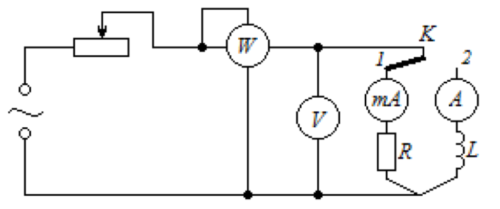

# Лабораторна робота № 7

## Вимірювання коефіцієнта потужності змінного струму

**Джерело:** [методичні вказівки](../../Електрика.%20Лабораторні%20роботи.pdf), с. 32–34. Опис структуровано за оригіналом; таблицю та пояснення знака реактивного опору додано.

## Мета

Ознайомитися з вимірюванням активної потужності та визначити коефіцієнт потужності й зсув фаз між напругою та струмом для ламп розжарювання і котушки індуктивності.

## Обладнання

- Електродинамічний ватметр Д 5004 до 750 Вт.
- Міліамперметр змінного струму до 500 мА й амперметр до 2,5 А.
- Вольтметр змінного струму до 130 В.
- Дві лампи розжарювання з опором 25 Ом у холодному стані.
- Реостат, ключ, ЛАТР для установки 50 Гц, 130 В.
- Котушка: 90 мГн без осердя, 165 мГн з осердям, активний опір 6,3 Ом.

## Теорія

Для синусоїдального режиму середня активна потужність:

$$
P=U_{\mathrm{еф}}I_{\mathrm{еф}}\cos\varphi.
$$

У методичці потужність позначено $W$; тут використано $P$, щоб відрізняти фізичну величину від її одиниці - вата. $\varphi$ - зсув фази напруги відносно струму. Коефіцієнт потужності:

$$
\boxed{\cos\varphi=\frac{P}{UI}}.
$$

Далі $U$ та $I$ означають діючі значення. За вимірюваннями можна визначити:

$$
\lvert\varphi\rvert=\arccos\left(\frac{P}{UI}\right),\qquad
Z=\frac{U}{I},\qquad R=\frac{P}{I^2}=Z\cos\varphi,
$$

$$
\lvert X\rvert=\sqrt{Z^2-R^2}=Z\sin\lvert\varphi\rvert.
$$

Ватметр, вольтметр та амперметр визначають модуль кута, але самі по собі не встановлюють знак реактивного опору. Для індуктивної котушки приймають $X>0$. Для переважно активного навантаження ламп очікують коефіцієнт потужності близький до одиниці.

В ідеальному реактивному елементі енергія періодично накопичується і повертається джерелу, а середня активна потужність дорівнює нулю. Реальна котушка має втрати в обмотці та осерді, тому її активна потужність ненульова.

## Схема установки

*Рис. 15 з оригіналу, с. 34: W - ватметр; V - вольтметр; K - перемикач навантаження; положення 1 - лампи, положення 2 - котушка; окремі струмові прилади відповідають різним діапазонам.*

## Порядок виконання

1. Зібрати коло за рис. 15. Перед увімкненням і перемиканням навантаження повернути регулятор напруги до мінімуму, перевірити межі приладів.
2. Поставити ключ у положення 1: навантаження - дві лампи розжарювання.
3. Для трьох різних значень струму виміряти відповідні напругу $U$ та активну потужність $P$.
4. Для кожного рядка обчислити $\cos\varphi$, $\lvert\varphi\rvert$, $Z$, $R$ та $\lvert X\rvert$. Навести середні значення для ламп відповідно до завдання методички.
5. Перемкнути ключ у положення 2: навантаження - котушка. Використати амперметр, діапазон якого відповідає збільшеному струму.
6. Повторити три вимірювання для котушки без осердя, потім із наявним осердям або осердями.
7. Проводити вимірювання достатньо швидко, щоб нагрівання обмотки не змінювало її опір.
8. За номінальними напругою й потужністю лампи визначити опір гарячої нитки:

$$
R_{\mathrm{ном}}=\frac{U_{\mathrm{ном}}^2}{P_{\mathrm{ном}}}.
$$

9. Порівняти з виміряним опором, враховуючи кількість ламп, їх з'єднання та режим нагрівання. Зробити висновки.

> **Уточнення джерела.** Формулювання про «нульове положення реостатів» неоднозначне: нульовий опір не означає мінімальної напруги. Тут вказано мінімальний вихід ЛАТРа відповідно до функції регулятора. Паспортні 25 Ом стосуються холодної нитки; робочий опір залежить від температури. При усередненні результатів для різних режимів слід зберегти також окремі значення.

## Таблиця результатів

Для кожного навантаження записати три режими; за потреби додати рядки для різних осердь.

| Навантаження | № | $U$, В | $I$, А | $P$, Вт | $\cos\varphi$ | $\lvert\varphi\rvert$, град | $Z$, Ом | $R$, Ом | $\lvert X\rvert$, Ом |
| --- | --- | --- | --- | --- | --- | --- | --- | --- | --- |
| Лампи | 1 | | | | | | | | |
| Лампи | 2 | | | | | | | | |
| Лампи | 3 | | | | | | | | |
| Котушка без осердя | 1 | | | | | | | | |
| Котушка з осердям | 1 | | | | | | | | |

Для пасивного навантаження має виконуватися $0\le P/(UI)\le1$. Якщо результат виходить за ці межі, перевірити діапазони, множник ватметра, одиниці струму та похибки вимірювання. Не обчислювати $\arccos$ або корінь із фізично несумісних даних.

## Що подати у звіті

Схему, таблиці всіх режимів, обчислені параметри, середні значення та порівняння навантажень. Окремо навести номінальні дані лампи і розрахунок опору нитки. Пояснити втрати в котушці та вплив осердя на коефіцієнт потужності.

## Контрольні питання

1. Що називають діючими значеннями струму та напруги?
2. Що таке потужність електричного струму та в яких одиницях її вимірюють?
3. Чи втрачається енергія в ідеальному колі лише з реактивним опором?
4. Чому нагріваються залізні осердя? Яке нагрівається сильніше: суцільне чи набране з пластин, і чому?
5. Що таке коефіцієнт потужності та як він залежить від опору, ємності й індуктивності кола?

---

[До переліку робіт і загальних вказівок](../README.md)
