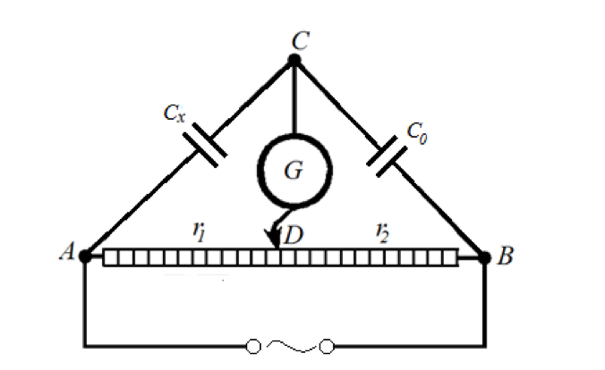

# Лабораторна робота № 8

## Визначення ємності конденсатора за допомогою мостової схеми Сотті

**Джерело:** [методичні вказівки](../../Електрика.%20Лабораторні%20роботи.pdf), с. 34–36. Опис структуровано за оригіналом; таблиці та пояснення друкарської помилки додано.

## Мета

Ознайомитися з мостовим методом вимірювання ємності. Визначити ємності двох конденсаторів і перевірити формули їх паралельного та послідовного з'єднання.

## Обладнання

Джерело змінного струму Б76, 12,6 В, 50 Гц; вольтметр В3-33 з максимальною межею 300 В і зазначеною в методичці точністю до 0,01 В; реохорд 110 Ом; еталонний конденсатор $C_0=2$ мкФ; два конденсатори невідомої ємності; з'єднувальні дроти.

## Теорія та схема

Для ідеального конденсатора модуль ємнісного опору:

$$
X_C=\frac{1}{\omega C},\qquad \omega=2\pi f.
$$

Тому вимірювання ємності можна звести до порівняння реактивних опорів. У міст Сотті вмикають невідомий та еталонний конденсатори; два інші плеча утворюють відрізки реохорда.

*Рис. 16 з оригіналу, с. 35. Мостова схема для визначення ємності конденсатора.*

У рівновазі напруги точок C і D збігаються за амплітудою та фазою; напруга на нульовому індикаторі мінімальна. Для позначень схеми:

$$
\frac{Z_{C_x}}{r_1}=\frac{Z_{C_0}}{r_2}.
$$

Оскільки комплексні опори ідеальних конденсаторів $Z_C=1/(j\omega C)$ мають однаковий фазовий множник, одержуємо:

$$
C_x=C_0\frac{r_2}{r_1}.
$$

Опори однорідного реохорда пропорційні довжинам $l_1=AD$ і $l_2=DB$, тому:

$$
\boxed{C_x=C_0\frac{l_2}{l_1}}.
$$

> **Уточнення джерела.** На с. 35 в пропорції двічі надруковано знаменник $R_1$. Для схеми та наступної формули другий знаменник має бути $R_2$. Тут також використано назву «нульовий індикатор»: список обладнання вказує вольтметр В3-33, хоча порядок виконання називає його гальванометром. Для реальних конденсаторів із помітними втратами ідеальна модель може не давати точного нуля.

## Похибка та формули з'єднань

Якщо похибкою еталонної ємності нехтувати, гранична відносна похибка за методичкою:

$$
\delta_C=\frac{\Delta l_1}{l_1}+\frac{\Delta l_2}{l_2}
=\left(\frac{1}{l_1}+\frac{1}{l_2}\right)\Delta l,
\qquad \Delta C_x=C_x\delta_C.
$$

Для міліметрової лінійки взяти $\Delta l_1=\Delta l_2=\Delta l=1$ мм. Якщо відома істотна похибка еталона, додати $\Delta C_0/C_0$. При фіксованій довжині реохорда похибка відліку найменша поблизу його середини.

Для двох конденсаторів:

$$
C_{\parallel}=C_1+C_2,\qquad
C_{\mathrm{посл}}=\frac{C_1C_2}{C_1+C_2}.
$$

## Порядок виконання

1. Зібрати схему за рис. 16, підключити перший невідомий конденсатор.
2. Встановити контакт D посередині реохорда, межу нульового індикатора - максимальну, 300 В.
3. Увімкнути джерело. Переміщенням контакту досягти мінімального показу індикатора.
4. Поступово зменшувати межу до 1–3 В та уточнювати положення рівноваги.
5. Записати $l_1$ і $l_2$, обчислити $C_1$. Повторити декілька разів.
6. Вимкнути джерело та розрядити конденсатори перед зміною схеми. Повторити дослід для другого конденсатора.
7. Виміряти ємності паралельного й послідовного з'єднань двох конденсаторів.
8. Перед кожним новим вимірюванням повертати індикатор на максимальну межу 300 В.
9. Розрахувати похибки. Порівняти виміряні ємності з'єднань з розрахунками через $C_1$, $C_2$ та зробити висновки.

## Таблиця результатів

Для кожного об'єкта додати рядки повторних вимірювань.

| Об'єкт | № | $l_1$, мм | $l_2$, мм | $C_x$, мкФ | $\delta_C$ | $\Delta C_x$, мкФ |
| --- | --- | --- | --- | --- | --- | --- |
| Конденсатор 1 | 1 | | | | | |
| Конденсатор 1 | 2 | | | | | |
| Конденсатор 1 | 3 | | | | | |
| Конденсатор 2 | 1 | | | | | |
| Паралельне з'єднання | 1 | | | | | |
| Послідовне з'єднання | 1 | | | | | |

| З'єднання | Розрахунок за $C_1,C_2$, мкФ | Виміряна середня ємність, мкФ | Абсолютна розбіжність, мкФ |
| --- | --- | --- | --- |
| Паралельне | | | |
| Послідовне | | | |

## Що подати у звіті

Схему, значення еталонної ємності, таблиці довжин, ємності та похибки, порівняння двох типів з'єднань. У висновку зазначити, чи узгоджуються експериментальні й розрахункові ємності в межах невизначеності.

## Контрольні питання

1. Які типи конденсаторів ви знаєте?
2. Що називають ємністю конденсатора і від чого вона залежить?
3. Чому через ідеальний конденсатор не проходить усталений постійний струм?
4. Виведіть формули паралельного та послідовного з'єднань конденсаторів.
5. Чому дорівнює енергія зарядженого конденсатора?
6. Як ємнісний опір залежить від частоти та ємності?
7. Як ємність залежить від властивостей речовини між обкладинками?
8. У яких приладах для дослідження фізико-хімічних властивостей і фазових переходів використовується міст Сотті?

---

[До переліку робіт і загальних вказівок](../README.md)
